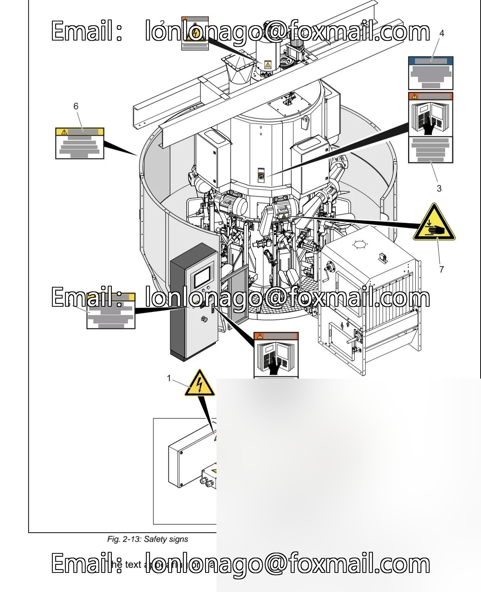
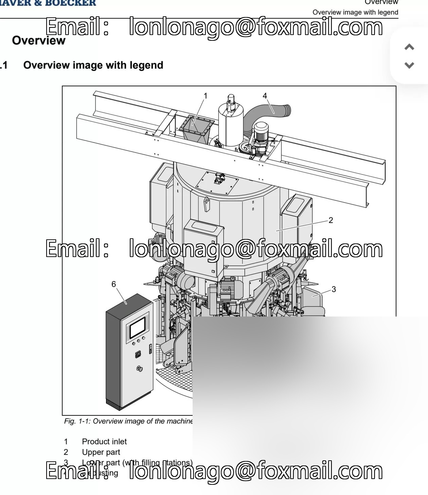

# ROTO-PACKER RVTs 6 packaging machine technical materials

## Body

ROTO-PACKER RVTs 6 Packaging Machine Technical Materials
PDF format, 290 pages.
Including detailed content such as structure, system, operation, and maintenance, suitable for reference by equipment engineers and maintenance personnel. The materials are , after taking photos a PDF file package will be provided, no return upon sale.

The technical material covers structure, systems, operation and maintenance for equipment engineers and repair personnel, with a PDF format and included content; the images show safety signs, machine parts, operation views and version information.

<!-- AI_ENRICHED -->

## Images

## Payment

Here is a pay link on Stripe ( https://buy.stripe.com/3cs8yP7sY87d0vu9AB ). Please contact me lonlonago@foxmail.com after funding $89, and I will send you a complete data files , thank you!

